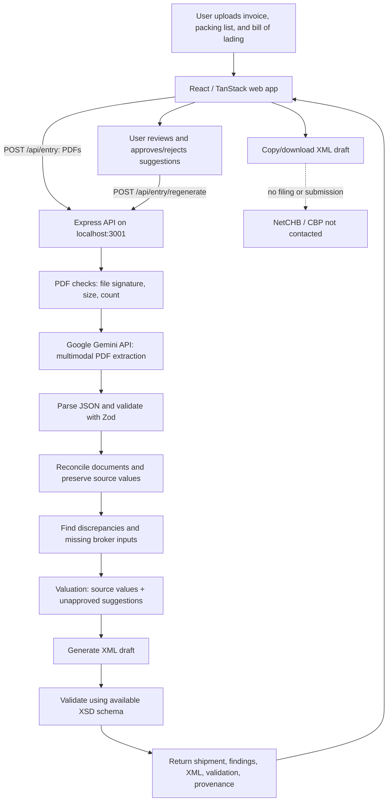

# Sefer Entry Workspace

Upload the documents for one import shipment (commercial invoice, packing list, bill of lading as PDFs). The app extracts the data with a model, reconciles the documents against each other, shows what is wrong or missing, and generates a **draft** NetCHB entry XML (`uploadEntry`, `entry.xsd` structure) that is checked against the NetCHB XSD.

**It never submits anything to NetCHB or CBP. A valid XML is not a correct entry and is not an accepted entry.** The app says "not ready to file" until a broker has supplied what the documents do not contain.

One project, one install: React/TanStack Start frontend in `src/`, Express backend in `server/`.

## What you need

| Requirement | Why |
|---|---|
| **Node.js 22.18 or newer** | The backend runs TypeScript natively; Vite needs a recent Node. `.nvmrc` records the baseline version. |
| **A current npm** | Installs both parts. Node 22.18 ships npm 10.9.x, which is fine. **Known issue:** npm 10.8.2 crashes in its own peer-dependency resolver with `Cannot read properties of null (reading 'edgesOut')` on this project; upgrade npm (`npm i -g npm@latest`) if you see it. Bun users can run `bun install` for the frontend (the existing `bun.lock` is preserved) and `npm install --prefix server` for the backend. `package-lock.json` files are committed for reproducible npm installs. |
| **A Gemini API key** | Extraction reads the PDFs with a model. Documents are sent to Google Gemini's API; do not upload anything you may not share. |
| **Network access** for `npm install`, `npm run fetch-schemas` and extraction | The npm registry, `strixsmart.com` (official XSD files) and `generativelanguage.googleapis.com`. |

No poppler, Tesseract or `xmllint` install is needed. XML validation uses the system `xmllint` if present and otherwise the bundled `xmllint-wasm` package, so it works on Windows out of the box.

## Run it (Windows, PowerShell)

```powershell
# 1. unzip, then:
cd sefer-entry-workspace

# 2. your own API key (never commit .env)
Copy-Item .env.example .env
notepad .env            # set GEMINI_API_KEY=your_google_ai_studio_key, save, close

# 3. install both parts (frontend + server)
npm run install:all

# 4. download the FULL official NetCHB schema (needs network). Without it the app falls back to a partial bundled schema and says so
npm run fetch-schemas

# 5. start API (port 3001) and web app together
npm run dev
```

Open the address Vite prints (normally <http://localhost:5173>). The banner at the top shows whether the backend is reachable, whether the key is configured, and which XSD check is in use.

Command Prompt: use `copy .env.example .env` instead of `Copy-Item`. macOS/Linux: `cp .env.example .env`.

## Environment variables

All are read from `.env` in the repo root (or `server/.env`); real environment variables win. See `.env.example` for the template. The API key is read by the backend only.

| Variable | Required | Default | Meaning |
|---|---|---|---|
| `GEMINI_API_KEY` | yes (for extraction) | – | Your Google Gemini key. Never sent to the browser, logged, or returned in a response. |
| `GEMINI_MODEL` | no | `gemini-3.8-flash` | Gemini API model id used for extraction. A value that is not a `gemini-<model-id>` id is ignored with a warning and the default is used. |
| `PORT` | no | `3001` | Backend port. |
| `HOST` | no | `127.0.0.1` | Bind address. Loopback only by default; this tool handles customs documents. |
| `SEFER_API_URL` | no | `http://127.0.0.1:3001` | Where the Vite dev server proxies `/api`. |
| `SEFER_SCHEMA_DIR` | no | repo `schemas/` | Directory the validator loads XSDs from. |

The default is `gemini-3.8-flash`, listed in Google’s official Gemini API model guide as a stable multimodal model with PDF input. Check current model availability and free-tier limits in Google AI Studio before use. A valid-looking ID does not guarantee your key has access to that model.

### Using the app

1. **Upload documents**: add the three PDFs and press *Process shipment*. Extraction takes some seconds.
2. **Review shipment**: summary and invoice lines are the values read from the documents. Edits are allowed; each one is sent to the backend and recorded, the extracted value is preserved.
3. **Resolve findings**: discrepancies (for example the T-shirt line amount, the hoodie quantity, mixed origin, the hand-corrected container number) and missing inputs. *Entered value and approvals* shows every component of the entered value with its provenance. Suggested components stay out until you tick them. Broker inputs (importer tax ID, processing port, surety, 10-digit HTSUS per line) are never inferred.
4. **Generate XML**: press *Regenerate XML* after any change, then copy or download the draft. The validation panel states exactly what was checked.

## Scripts (run from the project root)

| Command | What it does |
|---|---|
| `npm run install:all` | Installs frontend and server dependencies |
| `npm run dev` | Starts the API and the web app together (`dev:web`, `dev:server` start them separately) |
| `npm test` | Frontend tests (vitest) then server tests (`node --test`) |
| `npm run typecheck` | `tsc` for the frontend and the server |
| `npm run build` | Production build of the frontend |
| `npm run check` | typecheck, tests and build |
| `npm run fetch-schemas` | Downloads the official XSDs to `schemas/official/` and self-verifies them (complete, compiles, official sample validates) |
| `npm run trace -- <folder>` | Checks the sample fixture against the real PDFs. Needs poppler and tesseract (use WSL on Windows). Optional |
| `npm run lint` | ESLint (existing frontend config) |

## API contract

`POST /api/entry` with multipart field **`documents`** (up to 6 PDFs, 20 MB each; optional text field `broker` with JSON). Response (JSON): `shipment`, `findings`, `xml`, `validation` plus additive `source`, `valuation`, `assumptions`, `missing`, `edits`, `readiness`.
`POST /api/entry/regenerate` (JSON `{ source, shipment, broker }`) rebuilds the XML from the edited shipment. `GET /api/health` reports the service status (including the effective extraction model). Errors are `{ error, code }` with specific statuses (400, 413, 415, 422, 502, 503). The shape is checked in tests against the frontend's own Zod schema.

## Data integrity rules

* Values read from documents are never overwritten. Printed T-shirt amount stays **USD 6,480.00**.
* Anything proposed is a separate component with provenance: `source`, `derived`, `suggested`, `broker_approved`. The **USD 360** line-amount correction and the **USD 4,180** buyer-supplied-fabric assist are *suggested* and excluded from the entered value until approved. Default entered value: **22,899.00**; if both are approved: **27,439.00**.
* No 10-digit HTSUS code, importer ID, bond, processing port or broker decision is invented. Missing items stay visible, and the XML carries a visible `0000` placeholder for the processing port.
* The XSD check names the schema it used. Until `npm run fetch-schemas` succeeds it uses a bundled **subset** and the UI labels a pass as partial.

## Security and privacy

* The Gemini API key lives only in `.env` / the process environment, is read by the server, and is never sent to the browser, logged, or returned in any response. The Gemini REST API uses the key in the server-side request URL; never log that URL or expose it to the client. Google’s free-tier terms may allow submitted content to be used to improve its products; review current terms before sending confidential commercial/shipping documents. Use an appropriate paid/data-protected tier if confidentiality requirements demand it.
* Uploads are held in memory only: nothing is written to disk, filenames are never used as paths, and every upload is checked for PDF content (magic bytes), size and count. `.gitignore` excludes `.env*` (keeping only `.env.example`), `uploads/`, `tmp/` and `*.pdf`, so shipping documents cannot be committed by accident.
* The API listens on `127.0.0.1` only by default (`HOST` to change) and sets `nosniff` and `no-store` headers. There is no authentication: run it locally, do not expose it to a network as is.
* Document text is treated as data: the extraction prompt tells the model to ignore instructions inside documents, and the output is schema-validated before use.

## System architecture (plain-English diagram)

The browser handles the screens and user edits. The local backend receives the PDFs, asks Gemini to read them, checks the returned data, reconciles discrepancies, and generates an XML draft. It does **not** file anything with customs systems.



### What each part does

1. **Frontend:** lets you upload documents, review extracted shipment fields, resolve findings, and download XML.
2. **Express API:** validates uploads and coordinates the processing pipeline.
3. **Gemini:** reads both PDF text and scanned page images and returns structured JSON. It can make mistakes, so extracted values remain reviewable.
4. **Zod validation:** rejects responses that do not match the expected shipment data structure.
5. **Reconciliation and valuation:** compares invoice, packing list, and bill of lading; keeps printed values separate from calculated or suggested adjustments.
6. **XML generator and XSD validator:** builds a draft and checks it against the schema available locally. A bundled subset check is explicitly labelled partial.
7. **Human review:** broker-required values and proposed changes remain unresolved until a human confirms them. The app never submits entries to NetCHB or CBP.

## Project layout

```
src/                  frontend (TanStack Start, React): routes/index.tsx, components/entry/, features/entry/ (models, api client)
server/src/           Express app (app.ts, index.ts), api.ts (handlers), contract.ts (frontend contract), edits.ts
server/src/core/      extract, schemas (Zod), reconcile, valuation, entryXml, validate, mid, normalize, pipeline
server/test/          backend tests            src/test/   frontend tests and fixtures
schemas/              bundled subset XSDs      schemas/official/   created by fetch-schemas (git-ignored)
fixtures/             hand-transcribed sample shipment (test fixture, never used by the app at runtime)
scripts/              dev launcher, schema fetch, source trace, fixture generator
docs/                 RESEARCH.md, WRITEUP.md, source-trace.md, VERIFICATION.md, FINAL-VERIFICATION.md, test-results.txt, FRONTEND-BRIEF.md
sample-output/        XML and response generated for the sample shipment
```

## Verification status

See `docs/FINAL-VERIFICATION.md` (the authoritative record: commands, exit codes, counts) and `docs/test-results.txt`. Summary:

* **Latest verification run — 2026-10-18** (Node 22.18, clean `npm run install:all`): **94 backend tests** (93 passed, 0 failed, 1 opt-in live test skipped) and **27 frontend tests** under real `vitest` + `jsdom`; `tsc` for frontend and server (0 errors); `npm run build`; and all four sample XML files VALID against the **bundled subset** schema. These are the current numbers.
* **Historical (superseded) results.** Earlier dated runs recorded smaller totals as the suite grew (backend 67 -> 75 -> 81 -> 90 -> 93, frontend 26). They are kept in `docs/FINAL-VERIFICATION.md` as history only; the 2026-10-18 run above supersedes them.
* **Live Gemini extraction** was performed once, on **2026-10-11** (real `generateContent` call, HTTP 200, `gemini-3.8-flash`); it was **not** re-run in the latest pass. Evidence in `sample-output/*LIVE-GEMINI*`.
* **Not verified (still open):** validation against the **full official NetCHB/Strix schema** (`npm run fetch-schemas` cannot reach the schema host, so only the bundled subset is used), and the workflow through a **real browser** (exercised at the HTTP layer and through the live Gemini API instead).

If any of these fail on your machine, the output of `npm run check` and the browser error message are the starting point.

## Troubleshooting

* *Banner says "Entry service not reachable"*: the API is not running, or Vite is not proxying `/api` (set `SEFER_API_URL` if the API uses another address or port).
* *"Extraction model not configured"*: `.env` is missing or still contains the placeholder. Restart `npm run dev` after editing it.
* *Extraction fails with an HTTP error from the model*: check `GEMINI_MODEL` is a current documented id (or leave it blank to use the default) and that `GEMINI_API_KEY` is valid.
* *`npm install` crashes with `edgesOut`*: your npm is too old (10.8.x). Run `npm i -g npm@latest`.
* *XSD badge says "partial schema only"*: run `npm run fetch-schemas` with network access.
* *`fetch-schemas` fails*: it prints the failing URL or the validation error, records the failure in `schemas/official/.verified.json` and leaves the app on the bundled subset; it never leaves an unverified schema in use.
